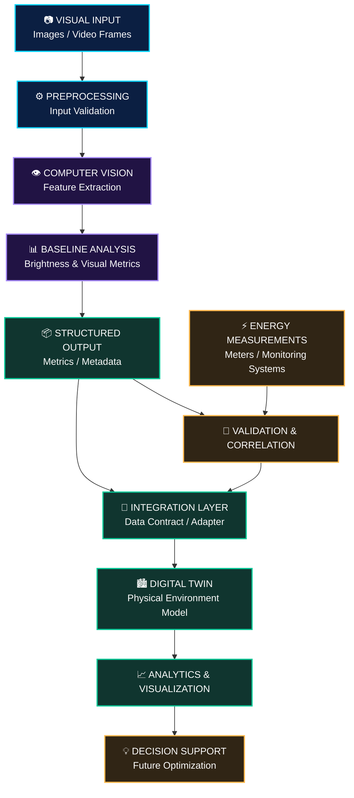

# ⚡ FLUXORA
### AI-Powered Energy Intelligence · Computer Vision · Digital Twins

<p align="center">
  
</p>

<p align="center">
  <a href="https://readme-typing-svg.demolab.com/">
    
  </a>
</p>

<p align="center">
  
  
  
  
</p>

<p align="center">
  <strong>Making energy visible. Making intelligence actionable.</strong>
</p>

<p align="center">
  <a href="#-abstract">Abstract</a> •
  <a href="#-the-vision">Vision</a> •
  <a href="#-system-architecture">Architecture</a> •
  <a href="#-the-mvp">MVP</a> •
  <a href="#-technology-stack">Tech Stack</a> •
  <a href="#-roadmap">Roadmap</a> •
  <a href="#-getting-started">Get Started</a>
</p>

---

## ◈ ABSTRACT

The growing demand for energy efficiency in modern buildings calls for intelligent systems capable of connecting environmental observations with meaningful, data-informed decisions. **Fluxora** explores an AI-driven approach to energy intelligence through the integration of computer vision, baseline visual analysis, and digital-twin technologies within a modular processing architecture.

The project focuses on developing a reproducible pipeline that processes visual inputs, extracts relevant features, and produces structured outputs suitable for downstream analytics and digital representations of physical environments. Its initial direction establishes a computer-vision baseline, with an architectural pathway toward integrating measured energy data, contextual analysis, and intelligent decision support. By connecting visual perception with digital-twin systems, Fluxora aims to provide a foundation for understanding building environments more contextually and supporting informed energy-management decisions. The effectiveness of the proposed approach and its potential contribution to energy savings require systematic evaluation using appropriate measurements and real-world validation.

**Keywords:** Energy Intelligence, Artificial Intelligence, Computer Vision, Digital Twins, Building Energy Efficiency, Visual Analytics, Energy Optimization.

---

## ◈ 00 — THE VISION

<p align="center">
  
</p>

**What if buildings could become easier to understand, monitor, and optimize through AI?**

Buildings consume energy every second. Yet energy readings alone do not always explain the physical conditions behind consumption, and visual observations alone cannot establish how much electricity a building uses.

Fluxora explores the space between these two sources of information.

Our approach begins with visual analysis, establishes a structured processing pipeline, and builds toward a system that can connect computer-vision outputs with a digital twin.

### The idea in one line

> **Visual perception → Intelligent analysis → Digital representation → Better-informed energy decisions.**

### The problem

- Energy data can lack the physical context needed to interpret what is happening in a building.
- Images and video contain information that must be processed before it becomes useful.
- Isolated AI models do not automatically integrate with building information systems.
- Energy optimization requires reliable evidence, not assumptions based on visual appearance alone.

### The Fluxora approach

| Traditional workflow | Fluxora's intended direction |
|---|---|
| Analyze individual readings | Combine relevant visual and measured information |
| Interpret images manually | Extract features through computer vision |
| Keep analysis separate from the environment model | Design structured outputs for digital-twin integration |
| Investigate inefficiencies after the fact | Explore earlier detection and data-informed analysis |
| Make decisions from disconnected observations | Work toward contextual, validated energy insights |

These are design goals and intended benefits, not claims that every capability is already operational.

---

## ◈ 01 — SYSTEM ARCHITECTURE

<p align="center">
  
</p>

Fluxora is designed around a modular pipeline in which each stage has a clear responsibility. This makes the system easier to develop, test, extend, and integrate.



<sub>Conceptual architecture. The actual digital-twin platform, integration protocol, energy-data sources, and operational capabilities depend on implementation.</sub>

### Architecture breakdown

<details>
<summary><strong>01 · Visual acquisition</strong></summary>

Collect supported images or video frames from the selected source. Inputs should be validated and associated with useful context, such as timestamps and asset identifiers, when available.

</details>

<details>
<summary><strong>02 · Preprocessing</strong></summary>

Prepare the inputs consistently for analysis. This stage can include validation, format handling, image normalization, and error handling as required by the implementation.

</details>

<details>
<summary><strong>03 · Computer vision</strong></summary>

Extract visual features using image-processing techniques. The initial baseline focuses on brightness-related analysis, providing a starting point for evaluating additional visual features.

</details>

<details>
<summary><strong>04 · Baseline analysis</strong></summary>

Calculate or evaluate relevant metrics, establish reference values, and compare observations where appropriate. The analysis must distinguish visual measurements from actual energy consumption.

</details>

<details>
<summary><strong>05 · Structured output</strong></summary>

Convert analysis results into a predictable data representation so they can be tested, stored, inspected, and transmitted to other components.

</details>

<details>
<summary><strong>06 · Digital-twin integration</strong></summary>

Use a defined integration boundary to connect validated outputs to the selected digital-twin platform. The adapter, schema, authentication, and update mechanism must be implemented and tested.

</details>

<details>
<summary><strong>07 · Analytics and decision support</strong></summary>

Build toward visualizing relevant observations and connecting them with independently measured energy data. Recommendations and optimization remain future capabilities until validated.

</details>

---

## ◈ 02 — THE MVP

### Building the first layer of energy intelligence

The MVP establishes the computer-vision foundation upon which the broader Fluxora architecture can evolve.

<p align="center">
  
</p>

### Core module 01 — Baseline brightness analysis

`src/baseline_brightness.py`

The baseline-brightness module is an identified component of the project. Its purpose is to provide a starting point for visual analysis.

Potential responsibilities include:

- Processing image pixel values.
- Calculating brightness-related statistics.
- Comparing observations against reference values.
- Providing reproducible results for downstream processing.
- Creating a foundation for additional visual-analysis features.

The precise metrics and calculations should be confirmed against the current source code.

### Core module 02 — Pipeline orchestration

`src/run_pipeline.py`

The pipeline entry point coordinates the execution of processing stages.

A robust implementation should aim to provide:

- Consistent input handling.
- Clear separation between processing stages.
- Predictable output formats.
- Understandable error handling.
- Reproducible execution and testing.

### Core module 03 — Digital-twin integration

The digital twin is a central direction for the wider Fluxora system.

The intended integration should enable structured analysis results to be associated with the relevant building, zone, or asset. The specific protocol and data model will depend on the chosen platform.

### MVP boundaries

| Capability | Status in this README |
|---|---|
| Baseline-brightness source module identified | Existing project component |
| Pipeline entry point identified | Existing project component |
| Automated evaluation and test coverage | To be verified |
| Versioned integration contract | To be implemented or verified |
| End-to-end digital-twin connection | Integration objective |
| Measured energy-data correlation | Future validation work |
| Automated energy-saving control | Future research and development |

**Important distinction:** image brightness is not electricity consumption. Camera exposure, reflections, lighting conditions, and other factors can affect visual measurements. Energy-related claims require appropriate independent measurements.

---

## ◈ 03 — THE DATA JOURNEY

<p align="center">
  
</p>

A typical intended data journey follows these stages:

1. **Observe** — receive an image or supported visual input.
2. **Prepare** — validate and preprocess the input.
3. **Analyze** — extract brightness-related or other implemented visual features.
4. **Structure** — represent results using a documented output schema.
5. **Integrate** — deliver supported outputs to a downstream system.
6. **Validate** — compare relevant insights against independent measurements where available.

### Example output contract

The following is a proposed schema illustrating the type of structured result that could be used for integration. It is not a representation of a verified current pipeline output.

```json
{
  "schema_version": "1.0",
  "asset_id": "example-building-zone",
  "timestamp": "2026-01-01T10:00:00Z",
  "analysis_type": "baseline_brightness",
  "metrics": {
    "mean_brightness": null
  },
  "metadata": {
    "source_type": "image",
    "measurement_domain": "visual"
  }
}
```

The actual schema should define the units, timestamp conventions, missing-value behavior, asset identifiers, and metric definitions used by the implementation.

---

## ◈ 04 — TECHNOLOGY STACK

<p align="center">
  
</p>

| Technology | Role |
|---|---|
| **Python** | Primary language for pipeline development |
| **OpenCV** | Candidate library for image processing and computer vision |
| **NumPy** | Candidate library for numerical operations |
| **Git** | Version control |
| **GitHub** | Repository hosting and collaboration |
| **Digital-twin platform** | Target integration environment; platform to be confirmed |
| **Visualization interface** | Future-facing presentation layer |

The icons represent the intended technical direction. Confirm the repository's dependency files before treating each library as an installed dependency.

### Why a modular stack?

Fluxora needs to support incremental development. Separating visual analysis from data contracts and platform integration makes it easier to test components independently and replace implementation details without redesigning the entire system.

---

## ◈ 05 — REPOSITORY STRUCTURE

```text
fluxora/
│
├── README.md
│
├── src/
│   ├── baseline_brightness.py
│   └── run_pipeline.py
│
├── tests/                  # Recommended: automated tests
├── data/                   # Recommended: test inputs
├── outputs/                # Recommended: generated results
├── docs/                   # Recommended: system documentation
│
└── requirements.txt        # If used by the project
```

The two Python modules above are identified project files. The remaining directories are recommended organizational elements and may need to be created or adapted to the actual repository.

---

## ◈ 06 — GETTING STARTED

### Prerequisites

- Python installed.
- Git installed.
- A local copy of the Fluxora repository.
- The dependencies required by the current project.

### Step 01 — Clone the repository

Replace the placeholders with the actual repository URL and directory.

```bash
git clone <YOUR_REPOSITORY_URL>
cd <YOUR_REPOSITORY_DIRECTORY>
```

### Step 02 — Create a virtual environment

**Windows PowerShell**

```powershell
python -m venv .venv
.\.venv\Scripts\Activate.ps1
```

**Linux / macOS**

```bash
python3 -m venv .venv
source .venv/bin/activate
```

### Step 03 — Install dependencies

If the project contains a `requirements.txt` file:

```bash
python -m pip install --upgrade pip
pip install -r requirements.txt
```

If no dependency file exists, inspect the imports and project configuration before installing packages individually.

### Step 04 — Inspect the source modules

From the correct repository root:

```powershell
Get-Content .\src\baseline_brightness.py
Get-Content .\src\run_pipeline.py
```

If the repository contains an additional nested project directory, adjust the paths accordingly.

### Step 05 — Run the pipeline

Inspect the entry point first to identify its required arguments and configuration.

```bash
python src/run_pipeline.py
```

The command is an example invocation. Actual execution may require an image path, configuration file, or other arguments defined by the script.

---

## ◈ 07 — ENGINEERING & VALIDATION

A successful execution is only the beginning. A useful energy-intelligence system must produce results that are reproducible, interpretable, and appropriately validated.

### Recommended testing checklist

- [ ] Valid inputs are accepted.
- [ ] Invalid or missing inputs produce understandable errors.
- [ ] Brightness calculations behave correctly on controlled test images.
- [ ] Repeated runs on identical inputs produce consistent outputs.
- [ ] Metric definitions and units are documented.
- [ ] Structured outputs conform to the documented schema.
- [ ] Integration failures are handled safely.
- [ ] End-to-end digital-twin data exchange is tested.
- [ ] Energy-related conclusions are compared with independent measurements.
- [ ] Performance and energy-saving claims are supported by reproducible evaluation.

### Design principles

<details>
<summary><strong>Reproducibility</strong></summary>

Inputs, configurations, and processing behavior should be documented so that results can be repeated and investigated.

</details>

<details>
<summary><strong>Modularity</strong></summary>

Keep preprocessing, visual analysis, output generation, and integration responsibilities separate.

</details>

<details>
<summary><strong>Interoperability</strong></summary>

Use documented, versioned data contracts to reduce coupling between the pipeline and external systems.

</details>

<details>
<summary><strong>Scientific validity</strong></summary>

Separate observed visual features, measured energy consumption, inferred conclusions, and proposed control actions.

</details>

<details>
<summary><strong>Responsible optimization</strong></summary>

Future control capabilities should require appropriate validation, authorization, and safety constraints.

</details>

---

## ◈ 08 — ROADMAP

<p align="center">
  
</p>

### Phase I — Foundation

- [x] Identify the baseline-brightness module.
- [x] Identify the pipeline orchestration entry point.
- [ ] Document actual inputs, outputs, and configuration.
- [ ] Create controlled test cases.
- [ ] Establish repeatable evaluation procedures.

### Phase II — Data & Integration

- [ ] Define a versioned output contract.
- [ ] Add structured metadata and error handling.
- [ ] Select the digital-twin integration platform.
- [ ] Implement the integration adapter.
- [ ] Verify end-to-end data exchange.

### Phase III — Energy Intelligence

- [ ] Integrate appropriate measured energy data.
- [ ] Evaluate relationships between visual features and energy readings.
- [ ] Establish meaningful comparison baselines.
- [ ] Assess additional visual-analysis features.
- [ ] Develop analytics and visualization capabilities.

### Phase IV — Intelligent Decision Support

- [ ] Investigate validated energy-efficiency indicators.
- [ ] Develop explainable, data-informed recommendations.
- [ ] Evaluate recommendations under representative conditions.
- [ ] Investigate safe, authorized optimization workflows.

<sub>Roadmap items describe planned work. The checked foundation items identify source modules, not independently verified completion of all their intended behavior.</sub>

---

## ◈ 09 — CONTRIBUTING

Fluxora is an evolving engineering project. Contributions that improve correctness, clarity, reproducibility, and system integration are welcome.

1. Fork the repository.
2. Create a feature branch.
3. Make a focused, testable change.
4. Add or update tests where appropriate.
5. Document changes to inputs, outputs, or configuration.
6. Submit a pull request with a clear description and validation results.

```bash
git checkout -b feature/your-feature
git add .
git commit -m "feat: describe your change"
git push origin feature/your-feature
```

Follow the project's established contribution guidelines where available.

---

## ◈ 10 — PROJECT STATUS

<p align="center">
  
  
  
</p>

Fluxora is being developed toward an integrated energy-intelligence workflow, starting with a computer-vision baseline and progressing toward digital-twin integration and validated energy analytics.

Operational readiness, test coverage, integration status, and measured performance should be reported only when supported by implementation evidence.

---

## ◈ 11 — THE BIGGER PICTURE

<p align="center">
  
</p>

The future of energy intelligence is not simply about collecting more data. It is about understanding the relationship between information, the physical environment, and the decisions that follow.

Fluxora begins with a focused computer-vision foundation and works toward a broader architecture in which visual observations, measured energy data, and digital twins can work together.

Our ambition is to build a system that is not only visually compelling, but also technically sound, testable, and capable of evolving through evidence-driven engineering.

<p align="center">
  <strong>⚡ FLUXORA</strong>
  <br/>
  <em>One pipeline. Multiple perspectives. A smarter approach to energy.</em>
</p>

<p align="center">
  
  
  
</p>

---

<p align="center">
  <sub>Fluxora · Computer Vision × Energy Intelligence × Digital Twins</sub>
</p>
