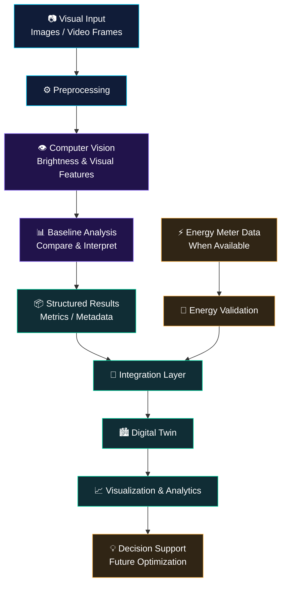

# ⚡ FLUXORA — Intelligence That Powers a Smarter Future

<p align="center">
  
</p>

<p align="center">
  <a href="https://git.io/typing-svg">
    
  </a>
</p>

<p align="center">
  
  
  
  
</p>

<p align="center">
  <strong>What if buildings could see their energy problems before those problems became expensive?</strong>
  <br/>
  Fluxora is our vision for an intelligent energy system that combines computer vision, energy analytics, and digital-twin integration to help transform building environments into systems that can be understood, monitored, and optimized.
</p>

<p align="center">
  <a href="#-the-big-idea">The Vision</a> •
  <a href="#-how-fluxora-works">Architecture</a> •
  <a href="#-technology-stack">Tech Stack</a> •
  <a href="#-roadmap">Roadmap</a> •
  <a href="#-get-started">Get Started</a>
</p>

---

## ◈ 00 — The Big Idea

Buildings consume energy. But understanding *why* energy is being wasted, where inefficiencies occur, and how a building could operate more intelligently is not always straightforward.

Traditional energy monitoring often focuses on readings, reports, and historical consumption. Fluxora explores a complementary approach: **use visual intelligence to understand the environment, connect observations to a digital representation, and build a foundation for smarter energy decisions.**

<details open>
<summary><strong>⚡ The Fluxora philosophy</strong></summary>

<br/>

| Conventional approach | The Fluxora direction |
|:---|:---|
| Look at energy readings in isolation | Combine visual context with energy information |
| Review inefficiencies after they occur | Explore opportunities for earlier detection |
| Work with disconnected observations | Connect perception, analysis, and a digital twin |
| Rely entirely on manual interpretation | Build toward AI-assisted insights |
| Treat buildings as static environments | Work toward continuously informed digital representations |

These are the project's design goals, not a claim that every capability is already implemented.

</details>

### ✦ Our mission

> **Make energy visible. Make inefficiencies understandable. Make intelligent optimization possible.**

Fluxora is being developed around a practical foundation: begin with a computer-vision MVP, establish a reproducible processing pipeline, and progressively connect its outputs to a digital-twin workflow.

---

## ◈ 01 — The Problem We Want to Solve

<details open>
<summary><strong>01. Energy inefficiencies are difficult to interpret</strong></summary>

Energy consumption numbers tell us what was consumed, but often do not explain the physical context behind a change. Visual information can provide useful context about the environment in which energy is used.

</details>

<details open>
<summary><strong>02. Visual data needs meaningful interpretation</strong></summary>

Raw images and video frames are not insights. They need preprocessing, feature extraction, analysis, and an output that downstream systems can understand.

</details>

<details open>
<summary><strong>03. Insights need a place to live</strong></summary>

A computer-vision model alone is not a complete energy-intelligence platform. Its outputs need to be structured so that they can eventually inform a building's digital representation, analytics, and decision-support interfaces.

</details>

<details open>
<summary><strong>04. Optimization needs trustworthy data</strong></summary>

Any future recommendations should be grounded in measured or validated information. Visual brightness, for example, is not the same as electrical power consumption. Fluxora must distinguish observable visual features from actual energy measurements.

</details>

---

## ◈ 02 — How Fluxora Works

<p align="center">
  
</p>

The system is designed as a pipeline: information enters, computer vision extracts useful signals, the analysis layer produces structured outputs, and the integration layer makes those outputs available for the digital twin.



<sub>Architecture concept: the visual-analysis pipeline is the foundation; measured energy data, digital-twin connectivity, and optimization capabilities depend on the corresponding implementation and integrations.</sub>

### The pipeline, explained

| Stage | Responsibility |
|:---|:---|
| `Input` | Accept images or video frames for analysis. |
| `Preprocessing` | Prepare inputs consistently for downstream processing. |
| `Computer Vision` | Extract visual features such as image brightness. |
| `Baseline Analysis` | Establish reference values and compare observations. |
| `Structured Results` | Organize outputs into usable metrics and metadata. |
| `Integration Layer` | Provide a defined boundary between analysis and other systems. |
| `Digital Twin` | Consume supported outputs to represent the relevant building or environment. |
| `Analytics` | Present information and support interpretation. |
| `Optimization` | Future work toward validated, data-informed recommendations. |

---

## ◈ 03 — The Core MVP

### 🔬 Computer Vision Meets Energy Intelligence

The initial MVP focuses on creating a dependable visual-analysis baseline rather than pretending that a single image can reveal a building's complete energy consumption.

<details open>
<summary><strong>⚙️ Baseline brightness analysis</strong></summary>

The current project structure includes a baseline-brightness module:

`src/baseline_brightness.py`

Its role in the architecture is to establish a reference implementation for brightness-related visual analysis.

Potential applications include:

- Calculating image-brightness statistics.
- Comparing frames or images against a baseline.
- Producing reproducible outputs for downstream analysis.
- Establishing a starting point for additional visual features.

The exact metrics, thresholds, and implemented behavior should be verified against the source code.

</details>

<details>
<summary><strong>🔄 Pipeline orchestration</strong></summary>

The project structure also includes:

`src/run_pipeline.py`

This is the pipeline entry point identified in the project. It provides the place to inspect how processing steps are initialized and executed.

A well-structured pipeline should make the workflow reproducible, its stages traceable, and its outputs easy to test.

</details>

<details>
<summary><strong>🏙️ Digital-twin integration</strong></summary>

The digital twin is a central architectural direction for Fluxora.

The intended integration boundary can carry validated analysis results, timestamps, asset identifiers, and other relevant metadata. The exact protocol and schema should be selected to match the digital-twin platform.

The integration should not be treated as complete until data exchange, error handling, and end-to-end behavior have been tested.

</details>

### What the MVP is — and isn't

| Capability | Project position |
|:---|:---|
| Visual-analysis baseline | Core development focus |
| Reproducible processing pipeline | Core development focus |
| Structured outputs for integration | Architectural requirement |
| Digital-twin connection | Integration objective |
| Actual electricity-consumption measurement | Requires appropriate measurement data |
| Automated energy-saving control | Future capability requiring validation and safeguards |

---

## ◈ 04 — Technology Stack

Fluxora's technology choices should support a lightweight, testable computer-vision pipeline that can evolve into a larger system.

<p align="center">
  
</p>

| Technology | Role |
|:---|:---|
| **Python** | Primary language for the processing pipeline. |
| **OpenCV** | Candidate library for image processing and computer vision, subject to the actual dependencies. |
| **NumPy** | Candidate for numerical image and feature calculations. |
| **Git & GitHub** | Version control, collaboration, and project documentation. |
| **Digital-twin platform** | Target integration environment; the specific platform must be confirmed. |
| **Visualization layer** | Future-facing presentation of insights and system status. |

**Important:** The icons above illustrate the intended technical direction, not proof that every library or platform is already installed or integrated. Confirm the project's dependency files before finalizing the stack.

---

## ◈ 05 — Repository Structure

The following is a conceptual map based on the identified source files. It is not a claim that every directory already exists.

```text
fluxora/
│
├── README.md
│
├── src/
│   ├── baseline_brightness.py   # Visual-analysis baseline
│   └── run_pipeline.py          # Pipeline orchestration
│
├── tests/                       # Recommended: automated tests
│
├── data/                        # Recommended: sample or test inputs
│
├── outputs/                     # Recommended: generated results
│
├── docs/                        # Recommended: architecture and setup
│
└── requirements.txt              # If used by the project
```

The source paths above reflect the project files identified during development. The additional directories are recommendations; adapt this structure to the repository's actual layout.

---

## ◈ 06 — The Data Journey

<p align="center">
  
</p>

Imagine a visual input entering Fluxora.

<details>
<summary><strong>01 — Observe</strong></summary>

A supported image or frame enters the pipeline. The input should have a clear source and, where appropriate, a timestamp and asset identifier.

</details>

<details>
<summary><strong>02 — Process</strong></summary>

Preprocessing prepares the input for analysis. Consistent processing is important when results need to be compared across different observations.

</details>

<details>
<summary><strong>03 — Analyze</strong></summary>

The baseline module computes or evaluates visual features. Additional metrics can be introduced as independently testable components.

</details>

<details>
<summary><strong>04 — Structure**

</summary>

The analysis result is represented in a predictable format, making it easier to inspect, store, test, and transmit.

Example of a *proposed output contract*, not a confirmed current output:

```json
{
  "asset_id": "example-building-zone",
  "timestamp": "2026-01-01T10:00:00Z",
  "analysis_type": "baseline_brightness",
  "metrics": {
    "mean_brightness": null
  },
  "metadata": {
    "schema_version": "1.0"
  }
}
```

The metric is intentionally `null`: the actual value must come from a real analysis run. The schema and timestamp convention must be adapted to the implementation.

</details>

<details>
<summary><strong>05 — Connect</strong></summary>

A supported integration layer can forward validated outputs to a digital twin. The receiving platform determines the actual API, schema, authentication, and update mechanism.

</details>

<details>
<summary><strong>06 — Learn & Improve</strong></summary>

Future iterations can compare visual observations with independent energy measurements and evaluate whether the additional features provide meaningful, validated insight.

</details>

---

## ◈ 07 — What Makes Fluxora Different?

<p align="center">
  
</p>

### 👁️ Visual context

Explore information that may be missing from numerical energy readings alone.

### 🧠 A modular intelligence pipeline

Keep image processing, baseline analysis, structured outputs, and system integration as distinct responsibilities.

### 🏙️ A digital-twin-first direction

Design outputs with the downstream environment in mind, instead of treating the computer-vision model as an isolated endpoint.

### 📊 Measurable, testable progress

Establish baselines, evaluate outputs, and introduce additional intelligence only when its behavior can be validated.

### 🔌 An architecture built to evolve

Leave room for additional data sources, richer visual features, analytics, and decision-support capabilities without requiring every component to be built at once.

---

## ◈ 08 — Roadmap

The following roadmap describes intended milestones. Update the status of each item as implementation is verified.

- [x] Establish a project-specific computer-vision baseline module.
- [x] Identify the pipeline orchestration entry point.
- [ ] Document the complete input/output contract.
- [ ] Add representative test images and repeatable evaluation cases.
- [ ] Implement automated tests for baseline behavior.
- [ ] Define a versioned data contract for downstream systems.
- [ ] Connect the pipeline to the selected digital-twin platform.
- [ ] Validate the end-to-end data flow.
- [ ] Introduce independently measured energy data where available.
- [ ] Evaluate correlations between visual features and energy measurements.
- [ ] Build an analytics interface for validated results.
- [ ] Investigate data-informed recommendations and safe optimization workflows.

<sub>The checked items identify source modules found in the project structure; they do not certify production readiness or passing tests.</sub>

---

## ◈ 09 — Get Started

### Prerequisites

- Python installed.
- Git installed.
- A local copy of the Fluxora repository.
- The project's required Python dependencies.

### 1. Clone the repository

Replace the example URL with the actual repository URL.

```bash
git clone <YOUR_REPOSITORY_URL>
cd <YOUR_REPOSITORY_DIRECTORY>
```

### 2. Create a virtual environment

**Windows — PowerShell**

```powershell
python -m venv .venv
.\.venv\Scripts\Activate.ps1
```

**Linux / macOS**

```bash
python3 -m venv .venv
source .venv/bin/activate
```

### 3. Install dependencies

If the repository contains `requirements.txt`:

```bash
python -m pip install --upgrade pip
pip install -r requirements.txt
```

If it does not, inspect the project imports and dependency configuration before installing packages individually.

### 4. Inspect the pipeline

From the repository root, inspect the identified modules:

```powershell
Get-Content .\src\baseline_brightness.py
Get-Content .\src\run_pipeline.py
```

The exact relative paths may differ depending on the repository root and folder nesting.

### 5. Run the pipeline

The precise invocation depends on how `run_pipeline.py` defines its entry point and input arguments. Inspect the module before running it:

```bash
python src/run_pipeline.py
```

If the script requires an image path, configuration file, or command-line arguments, supply those according to its implementation.

---

## ◈ 10 — Engineering Principles

Fluxora aims to follow a few core engineering principles as it develops.

| Principle | What it means |
|:---|:---|
| **Reproducibility** | The same input and configuration should produce predictable results. |
| **Modularity** | Processing, analysis, and integration should have clear boundaries. |
| **Observability** | Errors, inputs, outputs, and pipeline stages should be traceable. |
| **Validation** | Claims about energy performance should be supported by appropriate measurements. |
| **Interoperability** | Structured data should be easy for downstream systems to consume. |
| **Responsible optimization** | Future control actions must account for safety, authorization, and real-world constraints. |

### Why the distinction between brightness and energy matters

Image brightness is a visual property, not a direct measurement of electrical power. Camera exposure, lighting, reflections, and image processing can all affect pixel values.

A reliable energy-intelligence system therefore needs a clear separation between:

- **Observed features:** values extracted from images or video.
- **Measured energy:** readings from appropriate meters or monitoring systems.
- **Inferred insights:** conclusions evaluated against relevant data.
- **Control decisions:** actions that require validation and suitable safeguards.

This distinction is fundamental to making Fluxora useful beyond a visual demonstration.

---

## ◈ 11 — Evaluation & Testing

A meaningful MVP should demonstrate more than a successful script execution.

Recommended validation checklist:

- [ ] The pipeline accepts valid inputs.
- [ ] Invalid or missing inputs produce understandable errors.
- [ ] Brightness-related calculations behave as expected on controlled test images.
- [ ] Repeated runs on identical inputs are reproducible.
- [ ] Output values use documented units and conventions where applicable.
- [ ] Structured results can be parsed by a downstream consumer.
- [ ] Integration failures are handled without silently corrupting results.
- [ ] Digital-twin updates can be verified end to end.
- [ ] Any energy-saving claim is evaluated against a suitable baseline and independent measurements.

Do not publish performance numbers, accuracy claims, or energy-saving percentages until they have been measured and documented.

---

## ◈ 12 — Contributing

Fluxora is an evolving engineering project. Contributions that improve correctness, clarity, reproducibility, and integration quality are valuable.

1. Fork the repository.
2. Create a focused feature branch.
3. Implement a small, testable change.
4. Add or update tests where appropriate.
5. Document changes to inputs, outputs, and configuration.
6. Submit a pull request with a clear explanation and validation results.

```bash
git checkout -b feature/your-feature
git add .
git commit -m "feat: describe your change"
git push origin feature/your-feature
```

Use project-approved conventions for branch names, commits, and pull requests.

---

## ◈ 13 — Project Status

<p align="center">
  
  
</p>

Fluxora's development direction is to move from a focused visual-analysis baseline toward an integrated energy-intelligence workflow.

The project should be considered a work in progress until the actual implementation, automated tests, integration, and evaluation results establish which capabilities are operational.

---

## ◈ 14 — The Vision

<p align="center">
  
</p>

The future of energy intelligence is not just about collecting more data. It is about understanding what that data means, connecting it to the physical world, and turning validated insights into better decisions.

Fluxora begins with a focused computer-vision foundation and works toward a broader system in which visual observations, energy measurements, and digital twins can work together.

**One pipeline. Multiple perspectives. A smarter approach to energy.**

<p align="center">
  <strong>⚡ FLUXORA</strong>
  <br/>
  <sub>See energy differently.</sub>
  <br/><br/>
  
  
  
</p>
